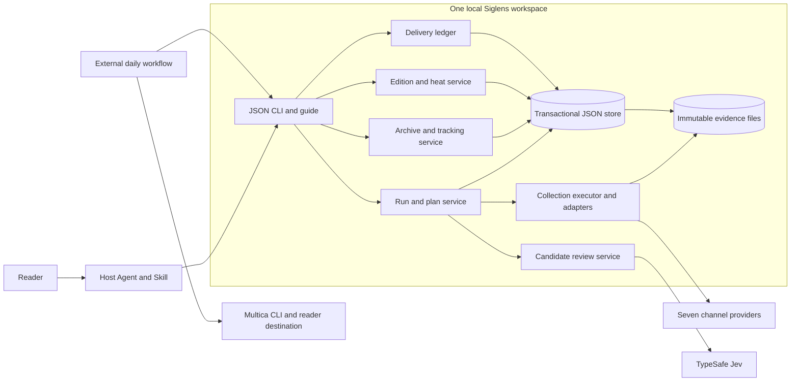
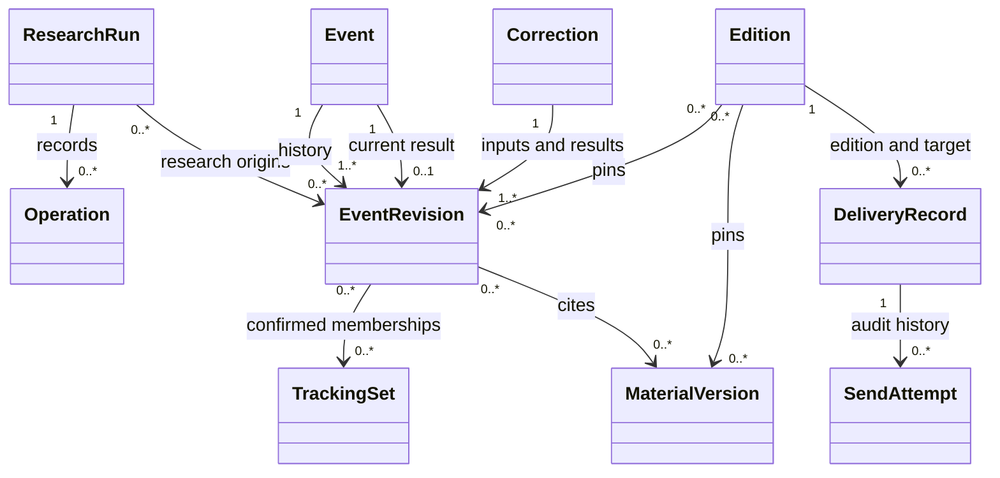
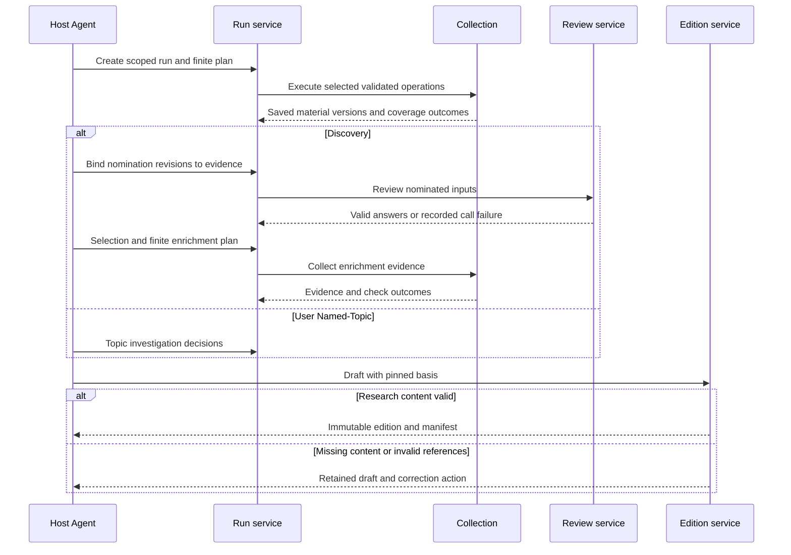
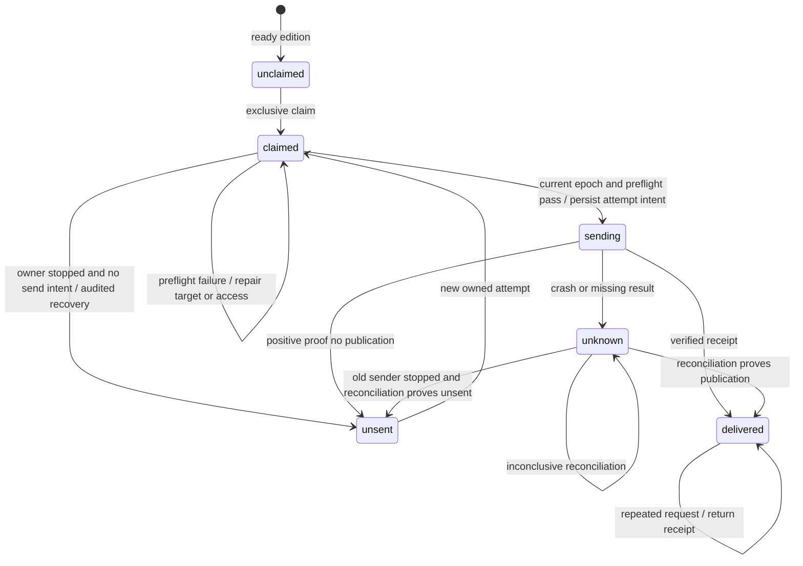

# Technical Design: Siglens Research and Event Continuity

- Mode: overall
- Status: IN_REVIEW for the shared core and non-X boundaries; DRAFT for the X/Grok isolation decision (technical Q1)
- Version: v1
- Date: 2026-10-13
- Owner: Engineering Lead, acting as Architect
- Product Design: [product-design.md](product-design.md), approved v10 at [9c16ff29cf26d96ea126fbbb09494a91aae613d4](https://github.com/patgu9/Siglens/blob/9c16ff29cf26d96ea126fbbb09494a91aae613d4/doc/2026-10-10-siglens-research/product-design.md)
- Code Baseline: Greenfield at that same commit; no implementation, tests, or build configuration
- Related Features: F1–F9; SC1–SC8; no first-release scope removed
- Owning issue: [ISSUE-6](mention://issue/01a13437-0660-74e5-a7db-2d2182049029); coordination and product approval source: [ISSUE-5](mention://issue/01a133bc-88a1-7b10-80d4-f5f251e72ecf)
- Technical approval: Pending for every scope. Task breakdown: Pending.

The product approval is patgu9's “批准” at 2026-10-13 07:38:28 UTC, comment `01a13432-d18f-7150-91d4-182ecc79d09d`. It answers the full-version request `01a1342d-4b26-7112-b8ed-19cce05e4b3f` in ISSUE-5 thread `01a133c0-b1d8-7aed-8723-032fa00e7644`. Retrieve these through `multica issue comment list 01a133bc-88a1-7b10-80d4-f5f251e72ecf --thread 01a133c0-b1d8-7aed-8723-032fa00e7644 --tail 30 --compact --output json`. The pinned product file's Pending status predates that approval. The later [record-only revision 239b9c3](https://github.com/patgu9/Siglens/compare/9c16ff29cf26d96ea126fbbb09494a91aae613d4...239b9c382afb5620ab5badfd3fed7363049f5c74) does not replace the approved behavior baseline; its rules, examples, and SC text were compared unchanged.

## 1. Purpose and Scope

Provide a local, resumable research system that preserves event history and produces evidence-backed editions for external delivery. A Python CLI owns validation and persistence. A host Agent owns research judgments. The reader owns tracking choices. External orchestration owns scheduling, transport, publication, and reconciliation.

Included scope is the complete approved product: both entrypoints, seven channels, candidate review, Topic Research, archive corrections, tracking, heat, editions, operation guidance, and delivery records. Product Scope exclusions remain authoritative, including Comparable, browser fallback, automatic expiry, cross-machine transport, dashboards, quotas, and public package release. The two-day demonstration is an early observation of continuity, not complete acceptance.

| Quality goal and product source | Priority and tradeoff | Acceptance obligation |
| --- | --- | --- |
| Preserve evidence and committed history; F2-AC6, F5-AC4/AC5, F7-AC5 | Mandatory. Reject stale writes instead of silently accepting concurrent work. | T2, T3, T5 |
| Prevent blind duplicate delivery; F9-AC2–AC5 | Mandatory. Uncertainty may delay publication indefinitely pending reconciliation. | T6, T7 |
| Keep source content outside the action-authority boundary; F2-AC7 | Mandatory. An unverified adapter is unavailable, not permission to weaken isolation. | T8; technical Q1 |
| Honest coverage and judgment; F2-AC3, F3-AC7, F7-AC6 | Mandatory. Partial results remain useful if their limits are visible. | T1, T4, T9 |
| Local operation with few moving parts; F8-AC1 | Proposed engineering preference: one package and local store before throughput or independent module deployment. No measured latency target exists. | T10; technical Q4 |

The mandatory goals do not compete by numeric weight. The proposed implementation preference must never relax them.

## 2. Current System and Constraints

| Evidence | Observation | Consequence and limit |
| --- | --- | --- |
| `git ls-tree -r --name-only 9c16ff2` | Only LICENSE and the product document exist. | No runtime, migration debt, reusable project code, or existing tests. All module names below are proposals. |
| Product approval thread and exact Git diff | Approval covers full v10; record synchronization changes no behavior. | Retain R1–R7, N1–N8, Q91–Q101. Product review was 3/3, last independent review on v9; v10's N8 change was author-checked only. Do not reopen closed product findings. |
| [SQLite transactions](https://www.sqlite.org/lang_transaction.html) and [atomic commit](https://www.sqlite.org/atomiccommit.html) | A transaction can group changes; concurrent writers are serialized. | Supports choosing a local transactional store. Filesystem and durability configuration still matter. |
| Bounded local SQLite probe, 2026-10-13 | Python 3.14.7 / SQLite 3.53.4: process exit before commit retained prior JSON; stale revision, duplicate claim, and old ownership epoch writes were rejected. | Feasibility evidence only. No product code, power failure, disk-full test, simultaneous race, or network publication was tested. Reproduction is in [evidence](evidence/overall-v1.md). |
| [TypeSafe Score](https://docs.typesafe.ai/primitives/score) and [API](https://docs.typesafe.ai/api), read 2026-10-13 | Five ordered criteria give positions 0–4. Scores can be fractional probability-weighted positions; answers are keyed by question ID. | Resolves the documentation basis for product Q95's decimals. Actual adapter responses, level anchors, and research quality remain unverified. |
| [last30days Grok adapter @ 50998cd](https://github.com/mvanhorn/last30days-skill/blob/50998cd1ba583f13a63b20e3fb5d906c71c31655/skills/last30days/scripts/lib/grok_x.py) | Its tool isolation is restricted to Grok 1.0.46 build 2765805b9442. Local `grok --version` returned 1.0.52 build 0920c8169e27. | Do not copy its isolation claims to this runtime. Q1 blocks the X security decision. No Grok search or credential inspection was run. |
| [uv tool guidance](https://docs.astral.sh/uv/guides/tools/) | Local tool installation is a supported distribution mechanism. | Package and clean Python 3.12 installation still require T10; no installation success is claimed. |

Reuse the [product glossary](product-design.md#glossary). Additional terms: a **revision** is an immutable version of one domain record; an **operation key** identifies repeat work within a run; an **ownership epoch** is a monotonically increasing local claim generation that rejects stale writers. None proves remote exactly-once execution.

No external collection engine is selected as a runtime dependency. last30days is reference material for adapter boundaries; importing its whole orchestration would bring unrelated research policy and unverified security behavior. Code reuse, licensing, and endpoint compatibility require examination in the relevant task. The independently operated `jev-ai/jev-api` site was excluded as authoritative Jev protocol evidence; the sources above are TypeSafe's documentation.

## 3. Behavioral Contracts

All F/SC/Q references below are product-v10 IDs unless explicitly prefixed “technical.” C and T IDs belong to this design. Range notation includes every intervening rule or example.

| Contract | Product sources | Shared agreement and consumers | Verification |
| --- | --- | --- | --- |
| C1 — Stable research identity | F1-AC1–AC4; F4-AC3/AC4; F8-AC3 | Run service, collectors, and finalizer share immutable entrypoint, origin, UTC half-open window, explicit daily designation/domain, and card maximum. A repeated operation reuses saved success including empty success. Explicit refresh creates a new operation generation without changing the window. | T1, T2 |
| C2 — Evidence and coverage | F2-AC1–AC7; F4-AC2 | Adapters return typed outcomes, provenance, content channel, retrieval route, text extent, observation time, and retained material versions. The executor enforces selection and readiness before every route; Web cannot retrieve explicitly disabled content. Archive and editions cite saved versions, not mutable URLs alone. | T1, T3, T8 |
| C3 — Review provenance | F1-AC1; F3-AC1/AC2/AC5–AC7; F7-AC2 | Review service binds a nomination revision, evidence input versions, rubric version, request/returned model identity, valid result or actual failed call, and Agent disposition. Finalizer checks the Discovery provenance chain; changing the label cannot bypass review. Direct user Named-Topic has no Jev prerequisite. | T4 |
| C4 — Atomic archive corrections | F5-AC1/AC4/AC5/AC8/AC9 | Archive service commits result revisions, current pointers, replacement relations, tracking choices, and audit records together against expected revisions. Reader confirmation binds the exact proposal and every result. Superseded revisions remain historical and never become extra active targets. | T2, T5 |
| C5 — Explicit tracking | F5-AC2/AC3/AC6/AC7 | Archive and daily executor share exact domain IDs and current event revisions. Origins and memberships are separate. Active requires a confirmed set. Check current active unresolved questions in the designated daily domain only. Pending choices retain the previous state. | T5, T9 |
| C6 — Research finalization | F6-AC1–AC5; F7-AC1–AC6 | Finalizer pins evidence and archive revisions, review basis, card identity, heat observations, and finalization time in an immutable edition. Content failure retains the draft; target failure occurs later. Required extracts and counterevidence accompany core conclusions. Repeated references do not hide extra cards. | T3, T9 |
| C7 — Delivery identity and ownership | F9-AC1–AC5; F7-AC4/AC5 | Ledger and external workflow use `(edition_id, canonical_target_id)`, fixed payload hashes, attempt ID, owner and epoch. Only the workflow sends. Successful receipts suppress repeat sends; unknown outcomes prohibit them. Cross-runner ownership is external. | T6, T7 |
| C8 — Agent interface and authority | F2-AC7; F8-AC1/AC2/AC4/AC5 | CLI returns versioned JSON with separate operation, coverage, research, edition, and delivery states; stderr carries diagnostics. Source text cannot submit plans or actions. Each plan is finite; the Agent decides further research. | T1, T8, T10 |

Local responsibilities complete coverage without turning every rule into a shared interface:

| Rules and complete example scope | Responsible module | Downstream design and observable verification obligation |
| --- | --- | --- |
| F1-AC1–AC4; F1-E1–E9 | Run/plan service | Validate entrypoint, source of user request, UTC endpoints, English output, integer card limit, fractional-day input and invalid-plan preservation. |
| F2-AC1–AC7; F2-E1–E11 | Collection executor and seven adapters | Design provider requests, readiness cache invalidation, source normalization and legal Web fallback. Exercise every coverage outcome, same-original provenance and source-instruction rejection. |
| F3-AC1–AC7; F3-E1–E11 | Review service plus host Skill | Design basic deduplication, nomination grouping and distinct dispositions. Verify one routine scoring stage, thin first-party leads, speculation, precise threshold arithmetic and genuine failure takeover. |
| F4-AC1–AC4; F4-E1–E8 | Topic Research plus host Skill | Design finite evidence plans and semantic review. Verify cards versus reports, uncertain time intervals, first-party claim limits and inconclusive findings without invented absence. |
| F5-AC1–AC9; F5-E1–E28 | Archive service plus reader interaction in Skill | Design correction proposals and validation. Verify histories, explicit memberships, all-result confirmation, cancelled/stale corrections, pause/resume and daily eligibility; T5 retains integration coverage. |
| F6-AC1–AC5; F6-E1–E11 | Heat module | Design count groups versus provider snapshots. Verify exactly-24h freshness, future/stale exclusion, metric meaning/unit separation, maximum valid value, missingness and sample count. |
| F7-AC1–AC6; F7-E1–E11 | Edition service plus host Skill | Design content schema/rendering and citation validation. Verify extracts, counterevidence, pending correction prompts, invalid drafts, partial/empty/interrupted distinctions and immutable correction editions. |
| F8-AC1–AC5; F8-E1–E7 | CLI/package, operation store and Skill | Design commands, errors, bounded retry and recovery guidance. Verify stdout JSON, cached empty results, lost-response uncertainty, standalone installation and external handoff boundaries. |
| F9-AC1–AC5; F9-E1–E10 | Delivery ledger plus external workflow | Design receipts, target canonicalization, reconciliation and timing presentation. Verify access before send, claim races, crash windows, delayed immutable delivery and serial runner transfer. |

Coverage exceptions: none. The unresolved X boundary affects its security feasibility, not its inclusion in the release. Compatibility starts from no prior implementation. Source IDs and approved product outcomes remain stable.

## 4. Approaches and Decisions

These are proposed technical decisions awaiting owner approval; they do not change product policy.

| Decision | Selected approach and basis | Alternative and tradeoff | Reopen condition / evidence |
| --- | --- | --- | --- |
| D1 — Deployment | One Python 3.12+ package, CLI and library modules; external host Skill. This matches F8 and one-reader scope. | Separate services increase deployment and transport obligations without a present requirement. Accepted cost: local availability and serialized mutations. | A supported workload cannot complete finite plans reasonably, or shared multi-host writes become required; Q4/T10. |
| D2 — Persistence | One local SQLite transaction envelope containing authoritative versioned JSON documents and indexes, plus retained evidence files. C4 needs atomic multi-record updates. | A set of independently replaced JSON files needs a separate transaction/recovery protocol. A single growing JSON snapshot amplifies every write. SQLite adds database backup requirements. | T2 disproves recovery on supported local filesystems; revise before storage acceptance. Network filesystems and simultaneously writable copies are unsupported. |
| D3 — External seams | Provider-specific adapters under one normalized collection contract; a separate Jev adapter and an external Multica delivery workflow. | Reusing an entire research engine couples Siglens to its ranking, fallbacks and orchestration. Direct adapters cost maintenance but preserve F2/F3 policy. | Protocol or access evidence contradicts required channels. Return policy changes through Product Manager; Q1/Q2. |
| D4 — Conservative delivery | Persist send intent before network publication; absence of a trustworthy result after that point means unknown. | Automatically reclaiming an expired lease is faster but cannot distinguish a sent message from an unsent one. Reject that alternative under F9-AC4. | T6/T7 expose an ownership path that can send twice; reopen C7 before activation. Remote idempotency is not assumed. |
| D5 — Evidence presentation | Default delivery body contains the minimum evidence, with saved Markdown companions when needed. Hash the edition and companion bytes. | Original links alone cannot preserve V1 access. Attachments are useful but create an access-check dependency; body delivery avoids it when practical. | T3 finds omitted extracts or inaccessible material. No fixed size limit or mandatory attachment format is invented. |

SQLite stores JSON text as the canonical research/state payload, not an alternative hidden domain schema. Derived `.json` views and Markdown files are readable materializations with schema/revision identifiers; they can be regenerated and never form a second writable authority. Indexes exist for reference checks, current revisions and uniqueness. Task design determines tables and local file layout within this agreement.

## 5. Technical Solution

### Boundaries and ownership

Proposed component/deployment view for C1–C8. This is simplified Mermaid flowchart notation, not a formal UML component diagram. Arrows mean “uses”; the box is the local trust and failure boundary.

Collection owns acquisition and normalization; it never chooses event identity. Archive owns current event pointers and revision history; it never sends. Edition reads pinned snapshots and owns finalized content; delivery owns receipt state only. A channel parser change stays in its adapter; a membership change affects archive, daily selection and their contract tests. These are module boundaries within one deployment, not services.

### Shared interfaces

Logical operation names below specify agreements for task coordination, not final command syntax.

| Interface / consumers | Required inputs and outputs | Rejection and ordering |
| --- | --- | --- |
| `create_run`, `submit_plan`, `resume` / Agent and executor | Schema version; explicit origin and scope; operation key; saved run revision; finite operations. Return stable run/operation IDs and C8 states. | Validate before mutation. Reusing a key with different input is a conflict; explicit refresh gets a new generation. Claim run execution locally; network work occurs outside database transactions. |
| `doctor`, `collect` / executor and adapters | Channel selection/configuration fingerprint and validated request; return C2 records with diagnostic causes. | Recheck affected readiness after configuration changes; no speculative fallback. Only selected, configured, validated channels execute. A parsing or request failure is not successful empty. |
| `review_nomination` / Agent and finalizer | Nomination revision and bound extracts/context, four versioned dimensions. Return raw answers or saved failure, then a separate Agent decision. | No scoring during nomination or automatic second scoring after enrichment. No valid four-score suggestion from a partial/invalid response. |
| `propose_correction`, `commit_correction`, `set_tracking` / Agent and archive | Expected archive/event revisions, result proposal identity, exact state/set choices, reader confirmation reference, reason. Return all committed result revisions or a repair action. | Confirmation must match the full current proposal. Transaction validates every result and swaps current pointers once. An incomplete choice is saved only as a pending proposal, never a current event. |
| `tracking_snapshot` / designated daily run | Exact domain ID and current archive revision. Return eligible current event revisions, unresolved questions and origin labels. | Revalidate eligibility before starting each not-yet-started check. A pause/removal stops subsequent active checks; an already in-flight read may finish and retain evidence without starting more work. |
| `finalize` / Agent and edition service | Draft revision, cited material/event versions and structured card identities. Return edition ID, finalization time, immutable JSON/Markdown manifest and hashes. | Validate all C6 inputs in one consistent view; preserve draft on failure. No target, schedule or publication prerequisite. |
| `claim`, `begin_send`, `record_result`, `reconcile`, `transfer_owner` / external workflow | C7 identity, epoch, attempt and hash bindings; target/access evidence; result provenance. Return permission, existing outcome, or concrete blocked action. | Only `begin_send` for the current owner permits a network attempt. All later mutations compare epoch/revision. See lifecycle below. |

Schema versions are explicit at the CLI and adapter boundaries. Unsupported major versions reject with a migration/correction action. Task designs define complete payloads, error codes and commands together with the guide; consumers must agree before implementation across that interface.

### Data relationships and immutable publication

Proposed UML class view for C1–C7. Associations show reference cardinality, not implementation classes. Every citation resolves an immutable material version; current-event lookup is a different operation.

One event has at most one current revision; an input identity can become historical or remain a result ID with a new revision. Replacement relationships refer to revisions, so retaining an ID cannot overwrite the original. Origin references never create tracking memberships. The archive uses one revision check for a mutation spanning multiple events; this deliberately rejects some unrelated concurrent edits in exchange for simple cross-run correctness.

Write and durably stage immutable evidence bytes before committing references to them. Commit evidence metadata and operation completion together only after file durability succeeds. A failed database commit can leave an unreferenced file; it cannot leave a valid reference to missing bytes. Keep and diagnose such files; no automatic evidence expiry or silent deletion. Finalization pins already persisted files and hashes in the database; failed Markdown materialization can be retried from the committed edition without creating another edition. Finalization returns success only when its required readable output is available.

### Order-sensitive research flow

Proposed UML sequence for C1–C6; it shows one finite plan. A later plan is an explicit new Agent request, not a CLI loop.

The Agent checks evidence support and research sufficiency. The CLI checks provenance, references, counts, times and state, without claiming to prove truth. Daily tracking under C5 runs alongside the domain research work and contributes labeled follow-ups. Pending merge/split proposals remain visible with host-Agent confirmation guidance, as required by N8.

### Delivery lifecycle and crash recovery

Proposed UML state machine for C7 and product Q96. “claimed” grants local ownership, while “sending” records that a network attempt is permitted. These states are separate from edition readiness.

The external workflow must await a successful durable `begin_send` before invoking Multica. A crash after that commit but before the network call is conservatively unknown, even if it probably sent nothing. A crash after claim but before any send intent is proven unsent only when the ledger is authoritative and the old owner has been stopped or fenced before intent can be obtained. Missing local records in a restored or copied store do not prove this history.

Owner transfer is explicit, never lease-expiry driven. The operator/external orchestrator stops the prior sender, records evidence of that stop, rereads the authoritative ledger, and atomically increments the owner epoch. A stale owner cannot obtain a new send permission or overwrite state. An epoch cannot revoke a network request already permitted or in flight: such an attempt remains unknown until reconciled. A successor may own reconciliation without permission to resend. If the old sender cannot be proven inactive, block transfer that could enable another send.

The audit records owner/epoch changes, caller identity, attempt intent time, payload hashes, target, receipt/reference, reconciliation evidence and reason. Preserve late receipts from former owners as evidence for the current reconciler; do not let them silently overwrite a newer attempt. Empty searches, elapsed time, an expired lock, and generic HTTP errors are not proof of unsent delivery. Positive evidence must distinguish no submission from possible remote acceptance.

Use the stable edition ID and content hashes as reconciliation markers in the external presentation. Read the authorized target through Multica CLI, including returned attachments, to match marker and content. A positive match can confirm publication and its supported timestamp. An ambiguous/missing result stays unknown; no unsupported server idempotency or exhaustive search guarantee is assumed. Delivery preflight and result handling are separate from research finalization.

Before send, use inline evidence where possible. If a companion is necessary, upload it, verify the saved identity/content and intended reader access, then publish the Briefing reference. If the platform cannot establish that access, block and repair the route. Preparing a companion is not Briefing delivery. A receipt confirms actual delivery time; attempt time never substitutes. The external wrapper carries planned/actual timing and delay labels while preserving the edition bytes and heat's finalization basis.

### Downstream task design

Planner assigns developers later; these are accountable responsibilities, not assignments.

| Module | Remaining design | Responsible role; resolution point and evidence |
| --- | --- | --- |
| Store, run service and CLI | Tables/indexes, JSON schemas, operation keys, filesystem staging, command/error forms and local packaging | Developer; before affected coding. Architect reviews C1/C4/C8 changes. T2/T10 must use the supported runtime and filesystem. |
| Seven adapters | Queries, pagination, provider parsing, timeouts, bounded retries, readiness invalidation and source authenticity labels | Adapter developer; protocol fixtures before coding, live known-event evidence before channel acceptance. X Q1 first requires Architect security investigation. |
| Review and Topic Research | Four five-level anchors, boundary samples, exact Jev serializer/parser, finite plans and semantic-review guidance | Research responsibility supplies rubric; developer supplies adapter; Architect verifies protocol. Q95/T4 before scoring acceptance, actual rubric before dependent integration. |
| Archive and tracking | Proposal/confirmation representation, reference validation and correction-specific transaction logic | Developer; high-risk task design reviewed by Architect before coding. T5 must include reused result IDs and partial confirmations. |
| Heat and editions | Local algorithms, content schema, renderers and citation validation | Developer; independent expected results from product examples before coding. T3/T9 before acceptance. |
| Ledger and external workflow | Canonical target format, sender stop evidence, access checks, receipt lookup, reconciliation and serial handoff procedure | Developer plus operator; Architect reviews task design before coding. T6/T7 and operator inputs before delivery activation. |
| Skill and installation guide | Reader confirmation dialogue, recovery examples, both entrypoints, external transport and daily workflow | Developer; examples tied to actual CLI, T10 before acceptance. |

Notation review is semantic only. Mermaid source is editable here; diagrams were not rendered. State-machine guards and transaction constraints remain authoritative where a diagram simplifies them.

## 6. Failure Modes and Operational Requirements

| Failure or operational area | Handling and observable outcome | Evidence obligation |
| --- | --- | --- |
| Provider unavailable, invalid response, rate limit | Persist exact coverage/failure cause and bounded continuation. Reuse successful and healthy-empty operations. No browser fallback or infinite retry. | T1/T4; real provider errors before adapter acceptance |
| Process interruption or stale writer | Short local transactions protect current state; run ownership prevents duplicate local execution. Lost upstream response remains uncertain; it may incur another request on retry. | T2; no hidden request-count guarantee |
| Disk full or corrupt/missing evidence | Fail the mutation, retain last complete commit; diagnose missing content and block dependent finalization/send. Never replace historical evidence with a new fetch. | T2/T3 on supported storage |
| Tracking correction incomplete/cancelled | Retain saved eligibility and current inputs; show pending confirmation. No result or membership is committed alone. | T5 |
| Source instruction / malicious URL | Data-only handling; no dynamic command execution. Restrict retrieval to allowed HTTP(S) routes; reject local/private network destinations and recheck redirects. Keep auth isolated by provider; redact secrets from state/logs. | T8; X Q1 gates its security decision |
| Target/access failure or missing receipt | C7 preserves edition; failed preflight sends no Briefing. Unknown blocks retry until external proof. | T6/T7 |
| Availability | Single local store is a deliberate single point of failure. Channel faults degrade coverage; store failure stops writes and publication permission. No unsupported uptime promise. | T1/T2; Q4 |
| Capacity and performance | Finite plans bound individual work, not paid research spending. Stream large responses and bound concurrent requests; store all retained versions. Watch disk space, operation latency, contention and provider limits. | Developer measures representative retained history; Q4. No benchmark or capacity number yet. |
| Observability | Correlate run, operation, evidence revision, edition and send attempt. Show state/coverage separately; audit archive decisions and ownership transfers. | T2/T5/T6 |
| Backup/restoration | Quiesce writes; create a consistent database backup and all referenced immutable files. Verify references/hashes before reopening. A restored ledger is not remote truth: disable sending until post-backup delivery history is reconciled and ownership is serial. | T7; operator backup cadence, loss and restore-time targets in Q4 |
| Migration / rollback | Version schemas; back up and migrate atomically before dependent commands. Reject a newer incompatible store. Rollback may require restoring a verified backup, with the delivery restriction above. Keep finalized bytes unchanged. | T2/T7; no existing data migration today |
| Distribution / activation | Local versioned wheel/repository installation through `uv tool`, console command and packaged guide; no Multica dependency for research. Enable external schedule only after required evidence and target/ownership setup. | T10 and Q3/Q4 |

Multi-tenant authorization, service replication and public package operations are inapplicable to the approved local first release. This does not remove source isolation, secret handling, or reader-access obligations.

## 7. Validation and TDD Strategy

Use the highest meaningful boundary: CLI/library contract tests with a real local store for state; recorded provider fixtures at the adapter boundary for parsing; live calls for actual provider compatibility; destination-reader checks for evidence access. Inject time and external responses, not archive invariants. Stubs cannot prove login, channel coverage, model quality, remote publication, or reader access.

All T scenarios are **Planned**, except the separately identified feasibility probe in Section 2. There are no existing product tests.

| Scenario | Conditions and observable acceptance | Owner / required stage and limits |
| --- | --- | --- |
| T1 — Two entrypoints and coverage (C1/C2/C8; SC1/SC2) | Run domain Discovery and user Named-Topic with seven-channel fixtures covering every outcome. Reject disabled-content Web fallback. Preserve fixed endpoints and explicit limits; real known-event trial records each channel's contribution and omissions. | Developers before component acceptance; QA/research responsibility before full acceptance. Fixtures do not prove live coverage. |
| T2 — Interruption and stale writes (C1/C4/C8; SC6) | Interrupt multi-record commits, race two writers, fill storage, resume successes and empty successes, and reject stale submissions. Observe either previous complete state or complete new state, never partial history. | Store/run developers before dependent acceptance; QA repeats integration recovery. Local probe covers only primitive feasibility. |
| T3 — Historical evidence and finalization (C2/C6; SC1/SC4) | E1 cites V1; acquire V2, correct event and finalize E2. Reader can still inspect E1's necessary V1 extracts and counterevidence. Missing extracts block finalization; inaccessible companions block only delivery. | Edition developer plus delivery operator before acceptance/activation. Requires a real destination-reader check. |
| T4 — Jev boundaries (C3; SC3; Q95) | Valid 1.99 raw maps below 3; raw 2.0 prevents four-low suggestion. Missing, nonfinite or out-of-range dimensions and real call failures do not fabricate scores. Preserve low-confidence values and input/rubric versions. Labeled speculation and thin first-party leads test Agent decisions separately. | Research responsibility and review developer before scoring acceptance; Architect verifies live protocol. No numeric accuracy target invented. |
| T5 — Joint correction and tracking (C4/C5; SC4/SC6) | Exercise all F5 examples, especially stale merge, retained result ID, unconfirmed split result, active with zero sets and cancelled last removal. After commit only current results are eligible in exact selected sets; old revisions and editions remain readable. | Archive developer with Architect task-design review before coding; integration acceptance with daily executor. |
| T6 — Claim/send crash matrix (C7; SC7; Q96) | Crash before intent, after intent before call, after remote acceptance before receipt, and after receipt persistence. Test old owner resuming after transfer. Only authoritative no-intent plus stopped/fenced owner or positive external proof permits retry; unknown never does. | Ledger/workflow developer before delivery acceptance. Real Multica trial separately from fault-injected sender. |
| T7 — Ownership and reconciliation (C7; SC7) | Competing local claims; late receipt; two copied ledgers; restore older backup; ambiguous destination lookup. Confirm at most one authorized external owner and retain unknown where proof is unavailable. Verify complete backup restore and hashes. | Operator and integration verifier before activation; local epochs alone cannot establish remote exclusivity. |
| T8 — Trust boundary (C2/C8; SC2) | Malicious source and query attempt tool execution, credential access, local URL/redirect access and disabled-channel retrieval. Observe no new authorized action or forbidden fetch. Probe actual supported Grok build and its tool registry before accepting X isolation. | Architect for X decision Q1; developers before adapter acceptance. Mock rejection cannot close Q1. |
| T9 — Two editions and heat (C5/C6; SC4/SC5; Q97) | Two real daily runs explain the same event's new evidence or bounded lack of observation; user names an actual replaced reading task. Cover 24h boundary, future values, provider rank/count separation, unknown time and card count. Delayed delivery preserves finalization-time heat. | Research/QA and user after implementation; early demonstration does not waive remaining SCs. |
| T10 — Independent operation (C8; SC8) | Clean Python 3.12+ installation via uv tool, Multica absent; Agent follows shipped guide through both entrypoints and interrupted operation. JSON responses remain parseable with stderr diagnostics. | Packaging/Skill developer and integration verifier before acceptance. Current host Python is not this test. |

Candidate increments for planner: (1) valid run → acquired evidence → local Named-Topic report, requiring store/CLI/adapter seams; (2) nominations → review/degradation → enriched Discovery edition, adding C3 and Q95 evidence; (3) event revisions/tracking → second-day follow-up, requiring C4/C5 and T5; (4) immutable evidence presentation → owned/reconciled external delivery, requiring T3/T6/T7; (5) complete seven-channel and all-SC acceptance. These are dependency suggestions, not assigned tasks or fixed schedule. Adapter investigation can proceed alongside core work after applicable approval; the X gate stays visible.

Task mode supplies concrete Red → Green → Refactor cases one behavior at a time, preserving failing reason, tested revision, actual command/result and limitations in each task's execution evidence. This document work used review and bounded investigation rather than a feature TDD cycle.

## 8. Premises and Open Questions

Technical Q IDs are document-qualified and do not replace product Q91–Q101.

| Type | Statement and impact | Evidence / validation status | Follow-up |
| --- | --- | --- | --- |
| technical Q1 / Fact / OPEN | X/Grok local-tool isolation on an actual supported build is unresolved. Blocks X isolation architecture approval, affected adapter breakdown and coding. Other adapters/core accept typed failure without exposing tools, so their design does not require X execution. Full seven-channel acceptance remains blocked. | Reference adapter permits only 1.0.46; installed 1.0.52 is outside its evidence. No live isolation probe. A profile description is not proof. | Architect investigates pinned build, registry, forced forbidden-tool calls and X-only retrieval in an isolated environment before enabling credentials or source ingestion. Operator supplies authorized login/test environment if required. If isolation fails, assess an OS/process boundary while preserving Grok login; a different access policy goes through Product Manager. |
| product Q95 / R5 / PARTIAL EVIDENCE | Decimal protocol basis documented; rubric and actual response compatibility remain open. Blocks dependent rubric integration and scoring acceptance, not core storage or Named-Topic planning once approved. | Official Score/API documentation supports C3. No live responses, labeled rubric or quality results. | Research responsibility supplies versioned four-dimension five-level anchors and samples; developer/Architect validate actual schema and model identity in T4. A threshold change returns to Product Manager. |
| product Q96 / R6 / DESIGN PROPOSED | C7 and lifecycle define recovery, transfer and audit. Blocks delivery acceptance/activation until T6/T7; not a claim of completed recovery verification. | Primitive local ownership checks passed; no sender integration or crash matrix executed. | Developer and operator implement/review protocol, including old-sender quiescence. Architect reopens if it cannot preserve unsent versus unknown. |
| product Q97 / R7 / OPEN | Two-real-brief order belongs to later planner. Complete F1–F9 and SC1–SC8 remain required. | Candidate increments in Section 7 only; no tasks or trial yet. | Engineering Lead using planner after applicable technical approval; research/user supply trial evidence later. |
| technical Q2 / Fact / OPEN | Live provider access and exact endpoint/parser behavior, especially direct public Digg data, remain unverified. Blocks each affected adapter acceptance; missing protocol samples block its dependent coding. | No authenticated or live collection calls. No failure is asserted merely from missing samples. | Adapter developer obtains primary protocol evidence and known-event fixtures before coding; operator supplies access before live acceptance. Return infeasible required routes to Architect/Product Manager. |
| technical Q3 / Configuration / OPEN | Schedule, timezone, destination permissions, reader access and serial cross-runner ownership are absent. Blocks external activation, not edition finalization. | No delivery target was configured or tested for the product. | Operator supplies configuration and T3/T6/T7 evidence before activation; preserve unknown if remote reconciliation is inconclusive. |
| technical Q4 / Assumption / OPEN | Single-reader local storage is sufficient; retention capacity and backup loss/restore-time needs are unmeasured. Blocks operational acceptance/activation, not the proposed core boundaries. No availability or data-loss target has been approved. | Measure representative retained history and restore a complete backup. Failure to finish finite research under intended use or excessive growth would disconfirm D1/D2. | Developer and operator measure, propose backup cadence/recovery targets and obtain owner agreement before activation. Escalate architecture changes if required; do not invent an SLA. |
| technical Q5 / Review and approval / OPEN | All technical scopes lack human approval. Core/non-X scope is ready for review; X scope also needs Q1 evidence. Blocks all task breakdown now. | Author self-review below; independent technical review 0 completed. Product approval does not approve this design. | Project Manager routes independent design review, then the exact applicable version/scope to patgu9. No fourth product review is requested. |

R1–R4 and N1–N7 retain their closed product dispositions. N8 remains the disclosed, approved author correction; C6 and the host Skill obligation preserve its prompt. Q98–Q101 are mandatory constraints in C4/C5, not questions reopened by this design. Product assumptions about added channel value, useful Jev judgments and replaced manual reading remain unvalidated and feed T1/T4/T9.

## 9. Review and Approval

Current review: author self-review of full technical v1 and this handoff, 2026-10-13, using technical-design's document contract, engineering review and document-review. Engineering Lead is also Architect; this is not independent review. Independent technical review requests dispatched by this author: 0; completed: 0. A separate review is requested through Project Manager at delivery.

Coverage: all 52 product rules and 106 examples assigned to shared or local verification, SC1–SC8, boundary ownership, alternatives, persistence, operations, dependencies, question gates and approval applicability. Semantic inspection covered the editable diagram sources. Mechanical checks cover the ten sections, source ID validity, local links, product record-only change boundaries and Git whitespace. Actual command/results are in [evidence](evidence/overall-v1.md). No runtime, product, installation, live scoring, source retrieval, power-loss, delivery, reader-access or user-benefit result is implied.

| Critical walkthrough / selection reason | Inspected path and conclusion | Limits / disposition |
| --- | --- | --- |
| T1/T4, distinct entrypoints and lawful degradation | Sequence: nominate → review result/failure → Agent decision → enrichment → finalizer. Direct user origin bypasses only the Discovery stage. Intentional skip has no failure record and cannot finalize. | Consistent by inspection; live Jev/rubric Q95 open. |
| T5, confirmation and concurrency | Correction reads expected revision, validates every confirmed result, commits current pointers and membership together. Retained-ID result gets a new revision. Stale, cancelled and partially confirmed paths leave old eligibility intact. | No storage-failure or concurrent product execution; T2/T5 remain required. |
| T3, source changes after publication | Edition pins V1 bytes and extracts; V2 adds a version. Target failure does not touch the edition; missing saved extracts prevent its creation. | Reader access requires T3; no attachment route tested. |
| T6/T7, dangerous crash window | Claimed/no-intent needs stopped owner and authoritative history; sending/no-result becomes unknown. Epoch transfer cannot erase an in-flight network effect. Restored/copied ledgers cannot authorize blind repost. | Local feasibility probe does not close Q96. |
| T8, external content authority | Collectors return data; CLI accepts validated plans from Agent. Reference Grok tool configuration cannot establish isolation for local 1.0.52. | Open finding technical Q1; X scope remains DRAFT. |
| T9, delayed publication and tracking | Current result and explicit domain set select checks; ordinary/paused membership does not. Finalization validates heat; later delivery only adds timing metadata. | Text walkthrough only; no two-day trial. |

Self-review correction: clarified that ownership epochs fence local mutations but cannot retract an already permitted network send. Rechecked the state machine, transfer rules, restored-ledger handling and T6/T7 against this limitation. The remaining architecture finding is Q1; other open evidence gates are recorded in Section 8. No closed product finding was reopened or represented as newly reviewed.

Approval: Pending for technical v1, all scopes. This file's review/status is a snapshot; later exact-version reviewer reports and owner approval on ISSUE-6 may supersede it. Any substantive revision requires affected re-review and applicable approval.

## 10. Handoff to Task Breakdown

Change directory: `doc/2026-10-10-siglens-research/`. The authoritative product and code baselines are pinned above. Sections 3–5 provide coverage, contracts, boundaries and downstream design obligations; Section 7 provides integration acceptance and candidate dependencies. Remaining feature schemas, commands, parser details and concrete test fixtures belong to task design.

| Scope | Status / approval | Ready for task breakdown | Blocker and next action |
| --- | --- | --- | --- |
| Shared core, archive/tracking, Topic Research, heat, editions, CLI/Skill and non-X adapter boundaries | IN_REVIEW / Pending | No | Q5: separate review and exact-scope owner approval. Interfaces can represent unavailable X without trusting it; this independence does not waive X acceptance. Q2/Q95/Q4 remain their stated downstream gates. |
| X/Grok isolation and adapter | DRAFT / Pending | No | Q1 and Q5: Architect must obtain supported-build isolation evidence before this security decision and dependent task breakdown. Preserve X in complete scope. |
| Delivery ledger and external workflow boundary | IN_REVIEW / Pending | No | Q5 now; Q96 and Q3 gate delivery acceptance/activation. Standalone edition finalization has no dependency on destination configuration. |
| Complete first release | Mixed / Pending | No | All scope above plus full SC1–SC8 verification. An early two-brief result cannot close this row. |

- Task breakdown: Pending; no plan, task files, development dispatch or implementation produced.
- Next function and recipient: Project Manager coordinates independent technical document review and the Q1 investigation with Architect. After applicable findings are resolved, submit the exact technical version and named scope to patgu9. Engineering Lead uses planner only after its input conditions and authorization are met.
- Planning continuity: retain this owning overall issue; later planning uses its one Task Planning child and preserves source identities. This design does not create that child.
- Feedback: technical Q1 is a scoped investigation blocker, not evidence that X is impossible or authorization to change the product route. Q95/Q96/Q97 retain their original owners and resolution stages.
