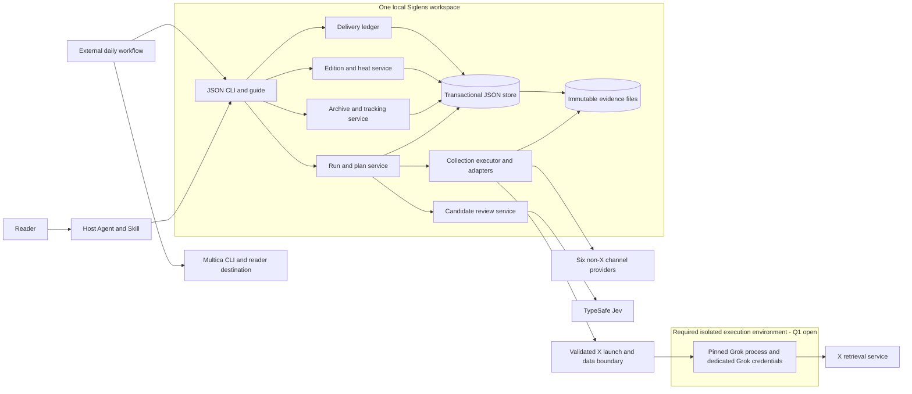
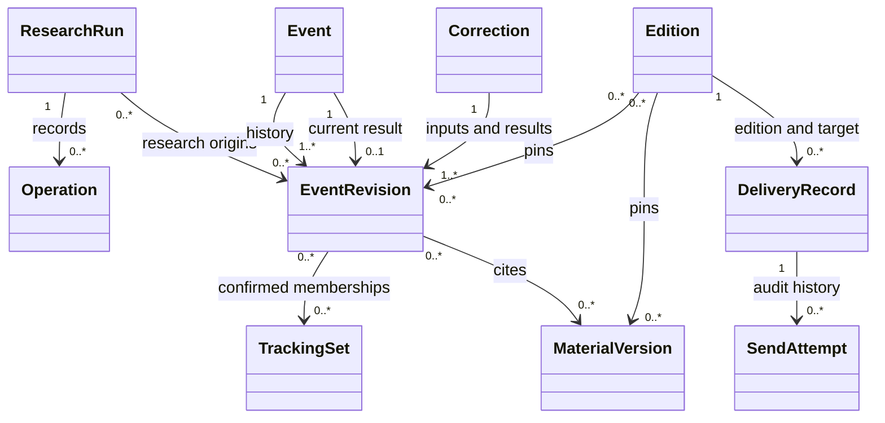
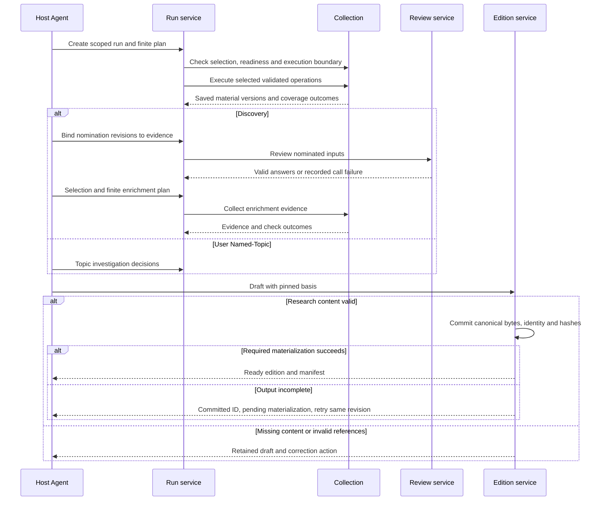
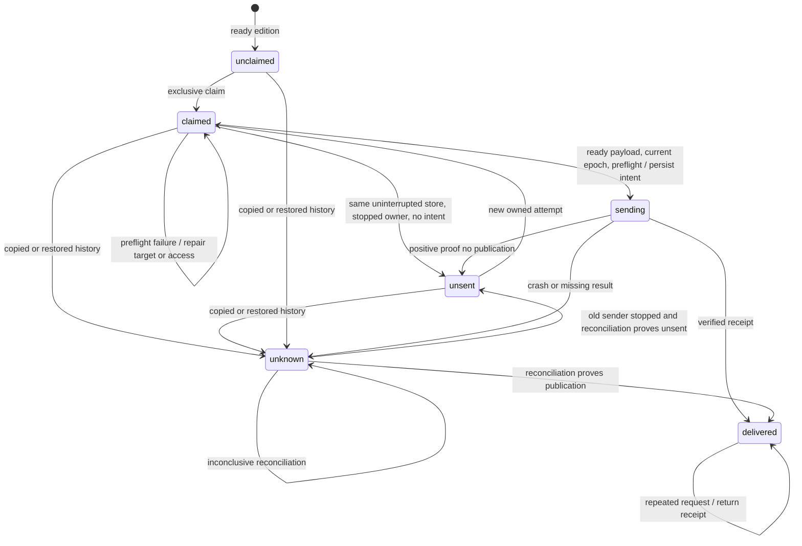

# Technical Design: Siglens Research and Event Continuity

- Mode: overall
- Status: IN_REVIEW for the revised data, research and delivery contracts; DRAFT for the execution/credential boundary and X/Grok deployment (technical Q1). Scope details are in Section 10.
- Version: v2
- Date: 2026-10-13
- Owner: Engineering Lead, acting as Architect
- Product Design: [product-design.md](product-design.md), approved v10 at [9c16ff29cf26d96ea126fbbb09494a91aae613d4](https://github.com/patgu9/Siglens/blob/9c16ff29cf26d96ea126fbbb09494a91aae613d4/doc/2026-10-10-siglens-research/product-design.md)
- Code Baseline: Greenfield at that same commit; no implementation, tests, or build configuration
- Related Features: F1–F9; SC1–SC8; no first-release scope removed
- Owning issue: [ISSUE-6](mention://issue/01a13437-0660-74e5-a7db-2d2182049029); coordination and product approval source: [ISSUE-5](mention://issue/01a133bc-88a1-7b10-80d4-f5f251e72ecf)
- Technical approval: Pending for every scope. Task breakdown: Pending.

The product approval is patgu9's “批准” at 2026-10-13 07:38:28 UTC, comment `01a13432-d18f-7150-91d4-182ecc79d09d`. It answers the full-version request `01a1342d-4b26-7112-b8ed-19cce05e4b3f` in ISSUE-5 thread `01a133c0-b1d8-7aed-8723-032fa00e7644`. Retrieve these through `multica issue comment list 01a133bc-88a1-7b10-80d4-f5f251e72ecf --thread 01a133c0-b1d8-7aed-8723-032fa00e7644 --tail 30 --compact --output json`. The pinned product file's Pending status predates that approval. The later [record-only revision 239b9c3](https://github.com/patgu9/Siglens/compare/9c16ff29cf26d96ea126fbbb09494a91aae613d4...239b9c382afb5620ab5badfd3fed7363049f5c74) does not replace the approved behavior baseline; its rules, examples, and SC text were compared unchanged.

## 1. Purpose and Scope

Provide a local, resumable research system that preserves event history and produces evidence-backed editions for external delivery. A Python CLI owns validation and persistence. A host Agent owns research judgments. The reader owns tracking choices. External orchestration owns scheduling, transport, publication, and reconciliation.

Included scope is the complete approved product: both entrypoints, seven channels, candidate review, Topic Research, archive corrections, tracking, heat, editions, operation guidance, and delivery records. Product Scope exclusions remain authoritative, including Comparable, browser fallback, automatic expiry, cross-machine transport, dashboards, quotas, and public package release. The two-day demonstration is an early observation of continuity, not complete acceptance.

| Quality goal and product source | Priority and tradeoff | Acceptance obligation |
| --- | --- | --- |
| Preserve evidence and committed history; F2-AC6, F5-AC4/AC5, F7-AC5 | Mandatory. Reject stale writes instead of silently accepting concurrent work. | T2, T3, T5 |
| Prevent blind duplicate delivery; F9-AC2–AC5 | Mandatory. Uncertainty may delay publication indefinitely pending reconciliation. | T6, T7 |
| Keep source content outside the action-authority boundary; F2-AC7 | Mandatory. An unverified adapter is unavailable, not permission to weaken isolation. | T8; technical Q1 |
| Honest coverage and judgment; F2-AC3, F3-AC7, F7-AC6 | Mandatory. Partial results remain useful if their limits are visible. | T1, T4, T9 |
| Local operation with few moving parts; F8-AC1 | Proposed engineering preference: one package and local store before throughput or independent module deployment. No measured latency target exists. | T10; technical Q4 |

The mandatory goals do not compete by numeric weight. The proposed implementation preference must never relax them.

## 2. Current System and Constraints

| Evidence | Observation | Consequence and limit |
| --- | --- | --- |
| `git ls-tree -r --name-only 9c16ff2` | Only LICENSE and the product document exist. | No runtime, migration debt, reusable project code, or existing tests. All module names below are proposals. |
| Product approval thread and exact Git diff | Approval covers full v10; record synchronization changes no behavior. | Retain R1–R7, N1–N8, Q91–Q101. Product review was 3/3, last independent review on v9; v10's N8 change was author-checked only. Do not reopen closed product findings. |
| [SQLite transactions](https://www.sqlite.org/lang_transaction.html) and [atomic commit](https://www.sqlite.org/atomiccommit.html) | A transaction can group changes; concurrent writers are serialized. | Supports choosing a local transactional store. Filesystem and durability configuration still matter. |
| Bounded local SQLite probe, 2026-10-13 | Python 3.14.7 / SQLite 3.53.4: process exit before commit retained prior JSON; stale revision, duplicate claim, and old ownership epoch writes were rejected. | Feasibility evidence only. No product code, power failure, disk-full test, simultaneous race, or network publication was tested. Reproduction is in [evidence](evidence/overall-v1.md). |
| [TypeSafe Score](https://docs.typesafe.ai/primitives/score) and [API](https://docs.typesafe.ai/api), read 2026-10-13 | Five ordered criteria give positions 0–4. Scores can be fractional probability-weighted positions; answers are keyed by question ID. | Resolves the documentation basis for product Q95's decimals. Actual adapter responses, level anchors, and research quality remain unverified. |
| [last30days Grok adapter @ 50998cd](https://github.com/mvanhorn/last30days-skill/blob/50998cd1ba583f13a63b20e3fb5d906c71c31655/skills/last30days/scripts/lib/grok_x.py) | Its tool isolation is restricted to Grok 1.0.46 build 2765805b9442. Local `grok --version` returned 1.0.52 build 0920c8169e27. | Do not copy its isolation claims to this runtime. Q1 blocks the X security decision. No Grok search or credential inspection was run. |
| [Controlled Q1 investigation @ dfd774c](https://github.com/patgu9/Siglens/blob/dfd774c20ef4d058aae00dfbfaf2904f1ea7311c/doc/2026-10-10-siglens-research/evidence/q1-investigation-v1.md) | Actual 1.0.52 binary with synthetic upstream: 24-tool control; profile removed main tools and rejected five forced calls. Configured MCP startup still ran (Q1-F1); an OS executable restriction stopped that canary. | Profile alone is insufficient. No existing login was accessed; live X, login-backed tools and a production OS boundary remain unverified. These bounded checks do not close Q1 or T8. |
| [uv tool guidance](https://docs.astral.sh/uv/guides/tools/) | Local tool installation is a supported distribution mechanism. | Package and clean Python 3.12 installation still require T10; no installation success is claimed. |

Reuse the [product glossary](product-design.md#glossary). Additional terms: a **revision** is an immutable version of one domain record; an **operation key** identifies repeat work within a run; an **ownership epoch** is a monotonically increasing local claim generation that rejects stale writers. None proves remote exactly-once execution.

No external collection engine is selected as a runtime dependency. last30days is reference material for adapter boundaries; importing its whole orchestration would bring unrelated research policy and unverified security behavior. Code reuse, licensing, and endpoint compatibility require examination in the relevant task. The independently operated `jev-ai/jev-api` site was excluded as authoritative Jev protocol evidence; the sources above are TypeSafe's documentation.

## 3. Behavioral Contracts

All F/SC/Q references below are product-v10 IDs unless explicitly prefixed “technical.” C and T IDs belong to this design. Range notation includes every intervening rule or example.

| Contract | Product sources | Shared agreement and consumers | Verification |
| --- | --- | --- | --- |
| C1 — Stable research identity | F1-AC1–AC4; F4-AC3/AC4; F8-AC3 | Run service, collectors, and finalizer share immutable entrypoint, origin, UTC half-open window, explicit daily designation/domain, and card maximum. A repeated operation reuses saved success including empty success. Explicit refresh creates a new operation generation without changing the window. | T1, T2 |
| C2 — Evidence and coverage | F2-AC1–AC7; F4-AC2 | Adapters return typed outcomes, provenance, content channel, retrieval route, text extent, observation time, and retained material versions. The executor enforces selection, readiness and the C8 execution boundary before every route; Web cannot retrieve explicitly disabled content. Archive and editions cite saved versions, not mutable URLs alone. | T1, T3, T8 |
| C3 — Review provenance | F1-AC1; F3-AC1/AC2/AC5–AC7; F7-AC2 | Review service binds a nomination revision, evidence input versions, rubric version, explicitly pinned request model version, returned model identity, valid result or actual failed call, and Agent disposition. A moving alias cannot authorize an automatic upgrade; mismatched or absent returned identity makes a received score response invalid. Finalizer checks the Discovery provenance chain; changing the label cannot bypass review. Direct user Named-Topic has no Jev prerequisite. | T4 |
| C4 — Atomic archive corrections | F5-AC1/AC4/AC5/AC8/AC9 | Archive service commits result revisions, current pointers, replacement relations, tracking choices, and audit records together against expected revisions. Reader confirmation binds the exact proposal and every result. Superseded revisions remain historical and never become extra active targets. | T2, T5 |
| C5 — Explicit tracking | F5-AC2/AC3/AC6/AC7 | Archive and daily executor share exact domain IDs and current event revisions. Origins and memberships are separate. Active requires a confirmed set. Check current active unresolved questions in the designated daily domain's explicit tracking set, including explicitly included cross-domain events. Pending choices retain the previous state. | T5, T9 |
| C6 — Research finalization | F6-AC1–AC5; F7-AC1–AC6 | Finalizer pins evidence and archive revisions, review basis, card identity, heat observations, and finalization time in an immutable edition. Content failure retains the draft; target failure occurs later. Required extracts and counterevidence accompany core conclusions. Repeated references do not hide extra cards. | T3, T9 |
| C7 — Delivery identity and ownership | F9-AC1–AC5; F7-AC4/AC5 | Ledger and external workflow use `(edition_id, canonical_target_id)`, hashes of committed canonical payloads, attempt ID, owner and epoch. Only the workflow sends. Successful receipts suppress repeat sends; unknown prohibits them. Only the same uninterrupted store that granted a claim can use absence of intent as local unsent evidence. Copies/restores use the recovery rules below, never absence alone. Cross-runner ownership is external. | T3, T6, T7 |
| C8 — Agent interface and authority | F2-AC7; F8-AC1/AC2/AC4/AC5 | CLI returns versioned JSON with separate operation, coverage, research, edition, and delivery states; stderr carries diagnostics. Source text cannot submit plans or actions. Each plan is finite; the Agent decides further research. The executor must establish the credential/process boundary below before enabling X credentials or ingesting source content; this requirement does not depend on a profile test passing. | T1, T8, T10 |

Local responsibilities complete coverage without turning every rule into a shared interface:

| Rules and complete example scope | Responsible module | Downstream design and observable verification obligation |
| --- | --- | --- |
| F1-AC1–AC4; F1-E1–E9 | Run/plan service | Validate entrypoint, source of user request, UTC endpoints, English output, integer card limit, fractional-day input and invalid-plan preservation. |
| F2-AC1–AC7; F2-E1–E11 | Collection executor and seven adapters | Design provider requests, readiness cache invalidation, source normalization and legal Web fallback. Exercise every coverage outcome, same-original provenance and source-instruction rejection. |
| F3-AC1–AC7; F3-E1–E11 | Review service plus host Skill | Design basic deduplication, nomination grouping and distinct dispositions. Verify one routine scoring stage, thin first-party leads, speculation, precise threshold arithmetic and genuine failure takeover. |
| F4-AC1–AC4; F4-E1–E8 | Topic Research plus host Skill | Design finite evidence plans and semantic review. Verify cards versus reports, uncertain time intervals, first-party claim limits and inconclusive findings without invented absence. |
| F5-AC1–AC9; F5-E1–E28 | Archive service plus reader interaction in Skill | Design correction proposals and validation. Verify histories, explicit memberships, all-result confirmation, cancelled/stale corrections, pause/resume and daily eligibility; T5 retains integration coverage. |
| F6-AC1–AC5; F6-E1–E11 | Heat module | Design count groups versus provider snapshots. Verify exactly-24h freshness, future/stale exclusion, metric meaning/unit separation, maximum valid value, missingness and sample count. |
| F7-AC1–AC6; F7-E1–E11 | Edition service plus host Skill | Design content schema/rendering and citation validation. Verify extracts, counterevidence, pending correction prompts, invalid drafts, partial/empty/interrupted distinctions and immutable correction editions. |
| F8-AC1–AC5; F8-E1–E7 | CLI/package, operation store and Skill | Design commands, errors, bounded retry and recovery guidance. Verify stdout JSON, cached empty results, lost-response uncertainty, standalone installation and external handoff boundaries. |
| F9-AC1–AC5; F9-E1–E10 | Delivery ledger plus external workflow | Design receipts, target canonicalization, reconciliation and timing presentation. Verify access before send, claim races, crash windows, delayed immutable delivery and serial runner transfer. |

Coverage exceptions: none. The unresolved X boundary affects its security feasibility, not its inclusion in the release. Compatibility starts from no prior implementation. Source IDs and approved product outcomes remain stable.

## 4. Approaches and Decisions

These are proposed technical decisions awaiting owner approval; they do not change product policy.

| Decision | Selected approach and basis | Alternative and tradeoff | Reopen condition / evidence |
| --- | --- | --- | --- |
| D1 — Deployment | One Python 3.12+ package for trusted CLI/library modules; external host Skill. X runs across the C8 process boundary, not inside the store's trust boundary. Its OS mechanism and login lifecycle remain DRAFT. | Separate services add transport/setup obligations. A separate OS identity or VM may still be necessary for X; package simplicity cannot waive isolation. | Q1 determines supported X deployment and credential provisioning before that scope's approval/breakdown. Q4/T10 cover workload and packaging. |
| D2 — Persistence | One local SQLite transaction envelope containing authoritative versioned JSON documents and indexes, plus retained evidence files. C4 needs atomic multi-record updates. | A set of independently replaced JSON files needs a separate transaction/recovery protocol. A single growing JSON snapshot amplifies every write. SQLite adds database backup requirements. | T2 disproves recovery on supported local filesystems; revise before storage acceptance. Network filesystems and simultaneously writable copies are unsupported. |
| D3 — External seams | Provider-specific adapters under one normalized collection contract; a separate Jev adapter and an external Multica delivery workflow. | Reusing an entire research engine couples Siglens to its ranking, fallbacks and orchestration. Direct adapters cost maintenance but preserve F2/F3 policy. | Protocol or access evidence contradicts required channels. Return policy changes through Product Manager; Q1/Q2. |
| D4 — Conservative delivery | Persist intent before publication. Missing outcome after intent, or incomplete history in any copied/restored ledger, means unknown. Require positive reconciliation before another send. | A certified final handoff could preserve more unsent cases, but needs an additional completeness protocol. Conservatively quarantine copies instead; accept possible indefinite delay over blind duplication. Lease expiry cannot prove unsent. | T6/T7 expose duplicate authorization; reopen C7 before activation. Remote idempotency is not assumed. |
| D5 — Evidence presentation | Default body contains minimum evidence, with Markdown companions when needed. Persist exact canonical body/companion bytes and hashes in the finalize transaction; materialize those bytes for readers and delivery. | Rerendering an immutable edition with a later renderer can change its hash. Reject that as delivery payload; immutable bytes cost retained storage but preserve reconciliation. Attachments still require reader-access checks. | T3 detects divergent bytes, incomplete materialization or inaccessible evidence; no fixed size or mandatory attachment format is invented. |

SQLite stores JSON text as the canonical research/state payload, with exact final publication bytes retained alongside it. Readable files never form a second writable authority. State views may be regenerated; edition body/companion materializations must copy the committed bytes exactly. Indexes support references, current revisions and uniqueness. Task design determines tables and local file layout within this agreement.

## 5. Technical Solution

### Boundaries and ownership

Proposed component/deployment view for C1–C8. This is simplified Mermaid flowchart notation, not a formal UML component diagram. Arrows mean “uses”; the local box contains trusted state services. The separate X boundary is required, with its enforcement mechanism still under Q1.

Collection owns acquisition and normalization; it never chooses event identity. Archive owns current event pointers and revision history; it never sends. Edition reads pinned snapshots and owns finalized content; delivery owns receipt state only. A channel parser change stays in its adapter; a membership change affects archive, daily selection and their contract tests. Trusted modules share one package; X additionally requires the separate execution boundary shown above.

### Execution and credential boundary (C2/C8)

The collection executor owns launch authorization. X executes in a separate process with a clean per-run HOME/GROK_HOME, minimal environment and explicit startup configuration. Its only credential capability is the separately authorized Grok login needed for X. The process must not read or write the Siglens store, ordinary user configuration, other providers' credentials or delivery credentials. Exchange only validated request data and bounded result data through the adapter boundary; the trusted executor persists results. A separate HOME or an empty tool registry alone does not enforce filesystem, process, network or IPC restrictions.

Before every invocation, resolve the executable and verify its exact version/build and digest against the investigated allowlist. Bind launch to the verified, protected executable; updater replacement between validation and execution must not bypass the check. No unvalidated build inherits another build's evidence. Validate the effective startup configuration, permitted endpoints and OS boundary before introducing credentials or real source content. Failure returns typed unavailable/validation failure under C2, without starting research or weakening restrictions.

Q1-F1 makes startup effects part of the boundary, even before a model request. Profile controls are defense in depth. The OS mechanism, credential provisioning/refresh/cleanup and supported platform set require Q1 evidence before execution/credential architecture approval or dependent breakdown/coding. Do not mount or copy the operator's existing login during investigation. Evaluate a dedicated authorized login with OS restrictions or an isolated OS identity/VM; current probes certify neither production option. D1 and T10 must include the selected boundary and fail-closed behavior. Data-only core contracts may be reviewed separately, but the shared launcher and packaging path are not independently ready.

### Shared interfaces

Logical operation names below specify agreements for task coordination, not final command syntax.

| Interface / consumers | Required inputs and outputs | Rejection and ordering |
| --- | --- | --- |
| `create_run`, `submit_plan`, `resume` / Agent and executor | Schema version; explicit origin and scope; operation key; saved run revision; finite operations. Return stable run/operation IDs and C8 states. | Validate before mutation. Reusing a key with different input is a conflict; explicit refresh gets a new generation. After a crash, an atomic run-epoch change permits takeover and rejects old-epoch writes. Potentially executed requests remain uncertain under F8-AC4; this rule does not grant delivery retry. Network work occurs outside database transactions. |
| `doctor`, `collect` / executor and adapters | Channel selection/configuration fingerprint and validated request; return C2 records with diagnostic causes. | Recheck affected readiness after configuration changes; apply the C8 launch gate on every X invocation. Only selected, configured, validated channels execute. A parsing or request failure is not successful empty. |
| `review_nomination` / Agent and finalizer | Nomination revision and bound extracts/context, four versioned dimensions. Return raw answers or saved failure, then a separate Agent decision. | No scoring during nomination or automatic second scoring after enrichment. No valid four-score suggestion from a partial/invalid response. |
| `propose_correction`, `commit_correction`, `set_tracking` / Agent and archive | Expected archive/event revisions, result proposal identity, exact state/set choices, reader confirmation reference, reason. Return all committed result revisions or a repair action. | Confirmation must match the full current proposal. Transaction validates every result and swaps current pointers once. An incomplete choice is saved only as a pending proposal, never a current event. |
| `tracking_snapshot` / designated daily run | Exact domain ID and current archive revision. Return eligible current event revisions, unresolved questions and origin labels. | Revalidate eligibility before starting each not-yet-started check. A pause/removal stops subsequent active checks; an already in-flight read may finish and retain evidence without starting more work. |
| `finalize` / Agent and edition service | Draft revision as idempotency basis, cited material/event versions and structured cards. Return the existing or newly committed edition ID, immutable manifest/hashes and materialization state. | Validate C6 before commit. Pre-commit failure retains the draft. Post-commit output failure returns the committed ID with pending materialization; success requires ready output. The publication table below defines retries. No target/schedule prerequisite. |
| `claim`, `begin_send`, `record_result`, `reconcile`, `transfer_owner` / external workflow | C7 identity, epoch, attempt and hash bindings; target/access evidence; result provenance. Return permission, existing outcome, or concrete blocked action. | Only `begin_send` for the current owner permits a network attempt. All later mutations compare epoch/revision. See lifecycle below. |

Schema versions are explicit at the CLI and adapter boundaries. Unsupported major versions reject with a migration/correction action. Task designs define complete payloads, error codes and commands together with the guide; consumers must agree before implementation across that interface.

### Data relationships and immutable publication

Proposed UML class view for C1–C7. Associations show reference cardinality, not implementation classes. Every citation resolves an immutable material version; current-event lookup is a different operation.

One event has at most one current revision; an input identity can become historical or remain a result ID with a new revision. Replacement relationships refer to revisions, so retaining an ID cannot overwrite the original. Origin references never create tracking memberships. The archive uses one revision check for a mutation spanning multiple events; this deliberately rejects some unrelated concurrent edits in exchange for simple cross-run correctness.

Write and durably stage immutable evidence bytes before committing references to them. Commit evidence metadata and operation completion together only after file durability succeeds. A failed database commit can leave an unreferenced file; it cannot leave a valid reference to missing bytes. Keep and diagnose such files; no automatic evidence expiry or silent deletion.

Finalization binds one draft revision to one edition. Prepare canonical UTF-8 body/companion bytes against a consistent input snapshot, then revalidate revisions and commit them with the immutable edition, finalization time, manifest and hashes in one transaction. The manifest identifies each exact payload part; hashes never refer to a later rendering. This shared agreement is needed by edition, ledger, workflow and reconciliation consumers.

| Publication condition | Persisted / caller-visible result | Permitted next action |
| --- | --- | --- |
| Content invalid or transaction fails | No new committed edition; draft remains available | Correct the draft or retry. A concurrent/repeated finalize of the same revision resolves to one committed identity. |
| Edition committed; required readable files incomplete | `committed_pending_materialization`, with edition ID and immutable hashes; finalize has not succeeded | Same-revision retry copies committed bytes, preserving ID/time/hashes. It must not rerender or create a second edition. No delivery claim or send. |
| Required files durably available and byte hashes match | `ready`; finalize succeeds | Claim may proceed subject to C7 and destination preflight. Missing/tampered files block both claim and `begin_send` until exact-byte repair. |
| Content or renderer changes after commit | Existing edition stays immutable | An intentional corrected edition uses a new draft revision. A retry or renderer upgrade cannot change existing payload bytes. |

Materialization status is operational metadata; it does not revise finalized research. Transport wrappers may add timing or attachment references outside the canonical payload parts. Reconciliation matches those parts' recorded identities and hashes; it does not mistake changing wrapper metadata for a new edition.

### Order-sensitive research flow

Proposed UML sequence for C1–C3/C6; it shows one finite research plan and finalization outcomes. Archive/tracking and heat are covered by their contracts and T5/T9, not this sequence. A later plan is an explicit new Agent request, not a CLI loop.

The Agent checks evidence support and research sufficiency. The CLI checks provenance, references, counts, times and state, without claiming to prove truth. Daily tracking under C5 runs alongside the domain research work and contributes labeled follow-ups. Pending merge/split proposals remain visible with host-Agent confirmation guidance, as required by N8.

### Delivery lifecycle and crash recovery

Proposed UML state machine for C7 and product Q96. “claimed” grants local ownership, while “sending” records that a network attempt is permitted. These states are separate from edition readiness.

The external workflow must await a successful durable `begin_send` before invoking Multica. A crash after that commit but before the network call is conservatively unknown, even if it probably sent nothing. Only the same uninterrupted store that granted the claim can use absence of intent to prove unsent, after the old sender is stopped or fenced before obtaining intent. “Uninterrupted” means the original durable store history, with no rollback, restore or copied-store substitution; a process restart alone does not change it. A matching store ID in copied bytes is not proof of continuity.

Owner transfer is explicit, never lease-expiry driven. For same-store transfer, the operator stops the prior sender, records stop evidence, rereads that store and atomically advances the owner epoch. A stale owner cannot obtain new permission or overwrite state. An epoch cannot revoke an already permitted network request: it remains unknown until reconciled. A successor may own reconciliation without resend permission. If the old sender cannot be proven inactive, block transfer that could enable another send.

For cross-runner transfer or any restore/rollback, the external workflow declares the store's recovery origin and keeps sending disabled. All non-delivered records become unknown, including unclaimed, claimed and formerly unsent records. Only verified delivered records retain delivered status and suppress repeat sends; an unverifiable receipt leaves unknown. Absent records or a missing target pair in an old snapshot also cannot authorize a fresh send: history completeness is unknown. Reconcile prior edition/target history before reopening sending, retaining unknown wherever external proof is insufficient. Stop evidence establishes serial ownership, not snapshot freshness or proof of no publication. The CLI cannot detect every undeclared filesystem copy; external orchestration must enforce the recovery gate and must never treat a copied store ID as authority.

The minimum external handoff contains source/destination runner and store lineage, recovery origin, ledger records with owner/epoch and all known attempts/results, edition/target identities, canonical body/companion bytes and hashes, retained evidence needed for reader access, and prior-sender stop evidence. Reconciliation adds remote receipts or positive nonpublication evidence and the successor ownership record. Missing content blocks delivery; missing history keeps unknown. External tools carry this package; no dedicated CLI research import/export or cross-machine transport feature is added. An old snapshot plus proof that runner A stopped therefore cannot let runner B resend A's possibly accepted publication (TR2).

The audit records owner/epoch changes, caller identity, attempt intent time, payload hashes, target, receipt/reference, reconciliation evidence and reason. Preserve late receipts from former owners as evidence for the current reconciler; do not let them silently overwrite a newer attempt. Empty searches, elapsed time, an expired lock, and generic HTTP errors are not proof of unsent delivery. Positive evidence must distinguish no submission from possible remote acceptance.

Use the stable edition ID and content hashes as reconciliation markers in the external presentation. Read the authorized target through Multica CLI, including returned attachments, to match marker and content. A positive match can confirm publication and its supported timestamp. An ambiguous/missing result stays unknown; no unsupported server idempotency or exhaustive search guarantee is assumed. Delivery preflight and result handling are separate from research finalization.

Before send, use inline evidence where possible. If a companion is necessary, upload it, verify the saved identity/content and intended reader access, then publish the Briefing reference. If the platform cannot establish that access, block and repair the route. Preparing a companion is not Briefing delivery. A receipt confirms actual delivery time; attempt time never substitutes. The external wrapper carries planned/actual timing and delay labels while preserving the edition bytes and heat's finalization basis.

### Downstream task design

Planner assigns developers later; these are accountable responsibilities, not assignments.

| Module | Remaining design | Responsible role; resolution point and evidence |
| --- | --- | --- |
| Store, run service and CLI | Tables/indexes, schemas, operation keys, staging and command forms; run-crash takeover with epoch fencing and uncertain upstream work (TR4) | Developer; before affected coding. Architect reviews takeover in task design; T2 checks resumed old writers and lost responses. T10 uses the supported runtime/filesystem. |
| Execution boundary and packaging | OS enforcement, protected executable launch, isolated login lifecycle and effective startup configuration | Architect resolves Q1 before this architecture's approval/breakdown; developer then refines the approved mechanism. T8/T10 require real isolation and supported-platform evidence. |
| Seven adapters | Queries, pagination, provider parsing, timeouts, bounded retries, readiness invalidation and source authenticity labels | Adapter developer; protocol fixtures before coding, live known-event evidence before channel acceptance. X Q1 first requires Architect security investigation. |
| Review and Topic Research | Four five-level anchors, boundary samples, exact Jev serializer/parser, supported pinned model ID and response-identity validation (TR7), finite plans and semantic-review guidance | Research responsibility supplies rubric; developer supplies adapter; Architect verifies fixed-version protocol before review-adapter coding. Q95/T4 before scoring acceptance; actual rubric before dependent integration. No alias fallback. |
| Archive and tracking | Proposal/confirmation representation, reference validation and correction-specific transaction logic | Developer; high-risk task design reviewed by Architect before coding. T5 must include reused result IDs and partial confirmations. |
| Heat and editions | Local algorithms, schemas, rendering and citation validation within the canonical-byte/materialization contract | Developer; independent expected results before coding. T3 checks same-revision concurrency, renderer change and interrupted materialization; T9 before acceptance. |
| Ledger and external workflow | Target format, continuity/recovery declaration, sender stop evidence, access checks, receipt lookup and external handoff procedure | Developer plus operator; Architect reviews C7 consumers together before coding. T6/T7 must cover stale snapshots and absent records; operator inputs before activation. |
| Skill and installation guide | Reader confirmation dialogue, recovery examples, both entrypoints, external transport and daily workflow | Developer; examples tied to actual CLI, T10 before acceptance. |

Notation review is semantic only. Mermaid source is editable here; diagrams were not rendered. State-machine guards and transaction constraints remain authoritative where a diagram simplifies them.

## 6. Failure Modes and Operational Requirements

| Failure or operational area | Handling and observable outcome | Evidence obligation |
| --- | --- | --- |
| Provider unavailable, invalid response, rate limit | Persist exact coverage/failure cause and bounded continuation. Reuse successful and healthy-empty operations. No browser fallback or infinite retry. | T1/T4; real provider errors before adapter acceptance |
| Process interruption or stale writer | Run-epoch takeover rejects stale mutations. It cannot retract an upstream request; possibly completed requests remain uncertain and a retry may incur another call. Delivery recovery uses C7 instead. | T2 and TR4; no hidden request-count guarantee |
| Disk full or corrupt/missing evidence | Fail the mutation, retain last complete commit; diagnose missing content and block dependent finalization/send. Never replace historical evidence with a new fetch. | T2/T3 on supported storage |
| Tracking correction incomplete/cancelled | Retain saved eligibility and current inputs; show pending confirmation. No result or membership is committed alone. | T5 |
| Source instruction / malicious URL | Data-only handling; no dynamic command execution. Restrict retrieval to allowed HTTP(S) routes; reject local/private destinations and recheck redirects. Apply the C8 credential/process boundary before X startup; redact secrets from state/logs. | T8; Q1 gates shared execution/credential and X deployment decisions, including startup effects |
| Target/access failure or missing receipt | C7 preserves edition; failed preflight sends no Briefing. Unknown blocks retry until external proof. | T6/T7 |
| Availability | Single local store is a deliberate single point of failure. Channel faults degrade coverage; store failure stops writes and publication permission. No unsupported uptime promise. | T1/T2; Q4 |
| Capacity and performance | Finite plans bound individual work, not paid research spending. Stream large responses and bound concurrent requests; store all retained versions. Watch disk space, operation latency, contention and provider limits. | Developer measures representative retained history; Q4. No benchmark or capacity number yet. |
| Observability | Correlate run, operation, evidence revision, edition and send attempt. Show state/coverage separately; audit archive decisions and ownership transfers. | T2/T5/T6 |
| Backup/restoration | Quiesce writes; back up the database and referenced immutable files. Verify references/hashes before reopening. Apply C7's recovery-origin gate, unknown conversion and external handoff rules; absence of a record cannot prove unsent. | T7 stale-snapshot and missing-record cases; Q4 for recovery targets |
| Migration / rollback | Version schemas; back up and migrate atomically before dependent commands. Reject a newer incompatible store. Rollback may require restoring a verified backup, with the delivery restriction above. Keep finalized bytes unchanged. | T2/T7; no existing data migration today |
| Distribution / activation | Local versioned wheel/repository installation through `uv tool`, console command and guide; research has no Multica dependency. X packaging must provide the proven C8 boundary and explicit login lifecycle or report X unavailable. Enable scheduling only after target/ownership and evidence gates. | T10 plus Q1 for execution packaging; Q3/Q4 before activation |

Multi-tenant authorization, service replication and public package operations are inapplicable to the approved local first release. This does not remove source isolation, secret handling, or reader-access obligations.

## 7. Validation and TDD Strategy

Use the highest meaningful boundary: CLI/library contract tests with a real local store for state; recorded provider fixtures at the adapter boundary for parsing; live calls for actual provider compatibility; destination-reader checks for evidence access. Inject time and external responses, not archive invariants. Stubs cannot prove login, channel coverage, model quality, remote publication, or reader access.

All T scenarios remain **Planned** product acceptance checks. Section 2 separately records storage feasibility and bounded Q1 isolation observations; neither completes a T scenario. There are no existing product tests.

| Scenario | Conditions and observable acceptance | Owner / required stage and limits |
| --- | --- | --- |
| T1 — Two entrypoints and coverage (C1/C2/C8; SC1/SC2) | Run domain Discovery and user Named-Topic with seven-channel fixtures covering every outcome. Reject disabled-content Web fallback. Preserve fixed endpoints and explicit limits; real known-event trial records each channel's contribution and omissions. | Developers before component acceptance; QA/research responsibility before full acceptance. Fixtures do not prove live coverage. |
| T2 — Interruption and stale writes (C1/C4/C8; SC6) | Interrupt commits, race writers, fill storage and resume saved successes/empty successes. Take over a crashed run, then resume the old writer: reject its epoch while retaining possible upstream execution as uncertain. Observe complete old or new state, never partial history. | Store/run developers before dependent acceptance; Architect reviews TR4 task design and QA repeats recovery. Local probe covers only primitive feasibility. |
| T3 — Historical evidence and finalization (C2/C6/C7; SC1/SC4) | E1 retains V1 extracts after V2/E2. Crash before finalize commit and after commit before materialization; retry concurrently with a changed renderer. Require one edition/time/hash per draft revision and exact canonical bytes. Pending/tampered output cannot be claimed or sent. Missing extracts prevent commit; inaccessible companions block delivery. | Edition and ledger developers before acceptance; operator verifies real destination-reader access before activation. No product finalization test has run. |
| T4 — Jev boundaries (C3; SC3; Q95) | Raw 1.99 maps below 3; raw 2.0 prevents the four-low suggestion. Reject missing, nonfinite or invalid dimensions. Request an explicit supported model version, reject a moving alias, and retain raw evidence while invalidating missing/mismatched returned identity. Invalid responses cannot supply scores; only a real failed call permits documented failure takeover. Preserve low-confidence values and input/rubric versions; labeled speculation and thin first-party leads still test Agent decisions separately. | Developer/Architect establish fixed-version protocol before adapter coding (TR7); research responsibility supplies boundary samples before scoring acceptance. Live model pinning remains unverified. |
| T5 — Joint correction and tracking (C4/C5; SC4/SC6) | Exercise all F5 examples, especially stale merge, retained result ID, unconfirmed split result, active with zero sets and cancelled last removal. After commit only current results are eligible in exact selected sets; old revisions and editions remain readable. | Archive developer with Architect task-design review before coding; integration acceptance with daily executor. |
| T6 — Claim/send crash matrix (C7; SC7; Q96) | Crash before intent, after intent before call, after remote acceptance before receipt, and after receipt persistence. Reject pending/mismatched payloads and resumed stale owners. Only the same uninterrupted grant store's no-intent evidence plus stopped/fenced owner, or positive external proof, permits retry. | Ledger/workflow developer before delivery acceptance. Real Multica trial separately from fault-injected sender. |
| T7 — Ownership and reconciliation (C7; SC7) | A commits intent and may publish; B receives an older pre-intent snapshot and A-stop proof. B must retain unknown and refuse retry, also when the old snapshot lacks the target pair entirely. Cover competing local claims, copied unsent records, verified delivered receipts, missing handoff bytes, late receipts, ambiguous lookup and restored backups. | Operator and integration verifier before activation; verify hashes and serial ownership independently. Local IDs/epochs or stop proof cannot certify remote history. |
| T8 — Trust boundary (C2/C8; SC2) | On the exact executable/build/digest, check startup processes and real registry, force forbidden calls, and test credential/store access, local URLs/redirects and disabled-channel retrieval. Replace the executable/config between checks and require fail-closed launch. Verify login-backed X-only retrieval in the isolated environment. | Architect resolves execution/credential and X architecture Q1 before dependent breakdown/coding; developers validate adapters before acceptance. Current synthetic-upstream evidence is partial, not a pass. |
| T9 — Two editions and heat (C5/C6; SC4/SC5; Q97) | Two real daily runs explain the same event's new evidence or bounded lack of observation; user names an actual replaced reading task. Cover 24h boundary, future values, provider rank/count separation, unknown time and card count. Delayed delivery preserves finalization-time heat. | Research/QA and user after implementation; early demonstration does not waive remaining SCs. |
| T10 — Independent operation (C8; SC8) | Clean Python 3.12+ installation via uv tool, Multica absent; exercise both entrypoints and recovery. Verify supported-platform C8 launch, isolated login provisioning/cleanup and unavailable-X behavior when the boundary is missing. JSON stdout remains parseable with separate stderr diagnostics. | Packaging/Skill developer and integration verifier before acceptance; execution packaging design depends on Q1. Current host Python and sandbox fixture are not this test. |

Candidate increments for planner: (1) valid run → acquired evidence → local Named-Topic report, requiring store/CLI/adapter seams; (2) nominations → review/degradation → enriched Discovery edition, adding C3 and Q95 evidence; (3) event revisions/tracking → second-day follow-up, requiring C4/C5 and T5; (4) immutable evidence presentation → owned/reconciled external delivery, requiring T3/T6/T7; (5) complete seven-channel and all-SC acceptance. These are dependency suggestions, not assigned tasks or fixed schedule. Adapter investigation can proceed alongside core work after applicable approval; the X gate stays visible.

Task mode supplies concrete Red → Green → Refactor cases one behavior at a time, preserving failing reason, tested revision, actual command/result and limitations in each task's execution evidence. This document work used review and bounded investigation rather than a feature TDD cycle.

## 8. Premises and Open Questions

Technical Q IDs are document-qualified and do not replace product Q91–Q101.

| Type | Statement and impact | Evidence / validation status | Follow-up |
| --- | --- | --- | --- |
| technical Q1 / Fact / OPEN | Effective X startup, credential/process isolation and login-backed X-only retrieval remain unresolved. Blocks shared execution/credential architecture, affected D1/T10 packaging, X approval and dependent breakdown/coding. Data-only services can use typed unavailable without launching X; this does not prove shared deployment independence. | [Pinned Q1 evidence](https://github.com/patgu9/Siglens/blob/dfd774c20ef4d058aae00dfbfaf2904f1ea7311c/doc/2026-10-10-siglens-research/evidence/q1-investigation-v1.md): real 1.0.52 local registry/dispatch observations, Q1-F1 MCP startup failure, bounded OS canary success. No production isolation or authenticated X evidence. | Operator supplies disposable runtime/separate OS identity, independent authorized Grok/X login, allowed endpoints/query and redacted trace/cleanup route via Project Manager. Architect investigates before credentials or real source ingestion under the chosen boundary. Product access-policy changes return to Product Manager. |
| product Q95 / R5 / PARTIAL EVIDENCE | Decimal protocol basis documented; rubric, explicit model pinning and actual response compatibility remain open. TR7 blocks review-adapter coding until the supported fixed-version request/response contract is verified; rubric integration and scoring acceptance retain their gates. | Official Score/API documentation supports the score semantics. Its moving alias example does not establish fixed-version support. No live fixed-version response, labeled rubric or quality result. | Developer/Architect obtain primary protocol evidence and an actual response with matching pinned identity before adapter coding; no alias fallback. Research responsibility supplies versioned anchors/samples before integration and T4 acceptance. If provider cannot support this constraint, return it through Project Manager to Product Manager. |
| product Q96 / R6 / DESIGN REVISED | C7 now defines same-store continuity, conservative copy/restore recovery, handoff content and immutable payloads. TR2/TR3 await independent confirmation before affected approval/breakdown; T6/T7 still gate delivery acceptance/activation. | v1 review found cross-runner authority and payload ambiguity. v2 author walkthroughs address both; no sender integration or crash matrix executed. | Reviewer checks revised C7/D4/D5 and consumers; developer/operator later implement and test old-sender quiescence, stale snapshots and materialization failures. Architect reopens if unsent cannot be distinguished safely. |
| product Q97 / R7 / OPEN | Two-real-brief order belongs to later planner. Complete F1–F9 and SC1–SC8 remain required. | Candidate increments in Section 7 only; no tasks or trial yet. | Engineering Lead using planner after applicable technical approval; research/user supply trial evidence later. |
| technical Q2 / Fact / OPEN | Live provider access and exact endpoint/parser behavior, especially direct public Digg data, remain unverified. Blocks each affected adapter acceptance; missing protocol samples block its dependent coding. | No authenticated or live collection calls. No failure is asserted merely from missing samples. | Adapter developer obtains primary protocol evidence and known-event fixtures before coding; operator supplies access before live acceptance. Return infeasible required routes to Architect/Product Manager. |
| technical Q3 / Configuration / OPEN | Schedule, timezone, destination permissions, reader access and serial cross-runner ownership are absent. Blocks external activation, not edition finalization. | No delivery target was configured or tested for the product. | Operator supplies configuration and T3/T6/T7 evidence before activation; preserve unknown if remote reconciliation is inconclusive. |
| technical Q4 / Assumption / OPEN | Single-reader local storage is sufficient; retention capacity and backup loss/restore-time needs are unmeasured. Blocks operational acceptance/activation, not the proposed core boundaries. No availability or data-loss target has been approved. | Measure representative retained history and restore a complete backup. Failure to finish finite research under intended use or excessive growth would disconfirm D1/D2. | Developer and operator measure, propose backup cadence/recovery targets and obtain owner agreement before activation. Escalate architecture changes if required; do not invent an SLA. |
| technical Q5 / Review and approval / OPEN | All technical scopes lack human approval. Revised contracts are submitted for affected review; Q1-dependent execution remains DRAFT. Blocks all task breakdown now. | Independent review 1/3 completed on exact v1, NOT PASSED (TR1–TR7); v2 has author self-review only. See Section 9 for the authoritative report and dispositions. | Project Manager coordinates affected independent review 2/3, then exact-version/named-scope approval by patgu9 when eligible. This revision does not count as independent review or product re-review. |

R1–R4 and N1–N7 retain their closed product dispositions. N8 remains the disclosed, approved author correction; C6 and the host Skill obligation preserve its prompt. Q98–Q101 are mandatory constraints in C4/C5, not questions reopened by this design. Product assumptions about added channel value, useful Jev judgments and replaced manual reading remain unvalidated and feed T1/T4/T9.

## 9. Review and Approval

Current artifact: **v2**, author self-review by Engineering Lead acting as Architect, 2026-10-13. The independent review count remains **1/3 requested, 1 completed**: Code Reviewer's **NOT PASSED** report on [v1 @ 060643a](https://github.com/patgu9/Siglens/blob/060643a5b3285ecaa811c813bcc4173098c0ee5a/doc/2026-10-10-siglens-research/technical-design.md). Its authoritative ISSUE-6 comment is `01a13454-4fce-7ce1-8164-fdc2e5dfa4eb`; retrieve with `multica issue comment list 01a13437-0660-74e5-a7db-2d2182049029 --thread 01a1344c-0ced-7d79-ba75-a3a41c25ccaf --tail 30 --compact --output json`. That review does not approve v2 or its new Q1 evidence.

The [v2 evidence and walkthrough record](evidence/overall-v2.md) contains the actual checks, exact input revisions and affected-review scope. Author review covers the full revised document and handoff: product coverage, shared contracts/consumers, model semantics, failure/recovery paths, deferred work, evidence limits and readiness. No product implementation, live service acceptance or independent review occurred in this revision. Mermaid remains unrendered.

| Finding / affected location | Author disposition in v2 | Outstanding scope and verification |
| --- | --- | --- |
| TR1 — C2/C8, D1, execution boundary, T8/T10 | Shared process/credential and per-invocation binary requirements are now unconditional. Q1-F1 rejects profile-only sufficiency. Shared execution/packaging remains DRAFT rather than claiming core-wide independence. | Proposed correction; independent confirmation pending. Q1 still blocks execution/credential and X architecture approval/breakdown/coding. Architect owns investigation; operator supplies isolated access. |
| TR2 — C7/D4, delivery recovery, T6/T7 | Only uninterrupted grant-store history can support local no-intent proof. Copy/restore gates include absent records, unknown conversion, serial ownership and minimum external handoff. | Proposed correction; blocks delivery approval/breakdown pending reviewer confirmation. Developer/operator must execute T6/T7 before acceptance/activation. |
| TR3 — D5/C6/C7, finalize, T3 | Exact committed canonical bytes define hashes; same-revision finalize is idempotent. Pending materialization or invalid payload blocks claim/send; repair copies the committed bytes. | Proposed correction; edition/delivery approval remains pending affected review. Edition/ledger developers share T3 responsibility. |
| TR4 — run resume, downstream Store row, T2 | Retained as a downstream obligation: crash takeover advances run epoch, fences old writes and records uncertain upstream execution. | Nonblocking for architecture approval. Developer resolves recovery in task design; Architect reviews before affected coding; T2 before acceptance. Delivery rules stay separate. |
| TR5 — C5 | Explicitly includes cross-domain events in the designated domain's confirmed tracking set. | Text correction for independent confirmation; T5 includes F5-E11/E14. No product membership policy changes. |
| TR6 — research sequence | Caption now names C1–C3/C6; readiness and pending-materialization branches are explicit. C4/C5 and heat coverage stays in its contracts/T5/T9. | Model correction for independent confirmation. Semantic review only; no Mermaid rendering result. |
| TR7 — C3/Q95/T4, downstream review row | Fixed model request version required; moving aliases and missing/mismatched returned identity cannot yield valid scores. | Nonblocking for architecture approval; fixed-version compatibility remains unknown and blocks review-adapter coding. Developer/Architect supply protocol evidence; policy changes route through Product Manager. |

| Critical v2 walkthrough / reason | Conclusion by inspection | Evidence limit |
| --- | --- | --- |
| T8/T10 — source authority and build drift | Required boundary precedes credentials/content; invalid executable/config returns unavailable. Data-only core need not launch X, but shared execution remains dependent on Q1. | Q1-F1 is actual bounded evidence; production boundary and authenticated X are unknown. |
| T6/T7 — stale cross-runner snapshot | A's possibly accepted send cannot become unsent on B merely because B lacks intent and A stopped. Recovery gate covers absent records too; inconclusive reconciliation retains unknown. | Text/model consistency, not a remote-send or backup test. |
| T3/T6 — committed edition with missing output | Retry after commit reuses ID/time/hash and copies canonical bytes. Renderer change cannot alter payload; claim/send wait for valid materialization. | No implementation, concurrency or filesystem failure injection. |
| T2 — crashed run and resumed old writer | New run epoch rejects old state mutations; possible upstream effects stay uncertain. This never authorizes a delivery resend. | Developer task-design and execution evidence still required. |
| T4 — model alias or identity drift | No automatic upgrade or fabricated valid scores. Actual failed response is retained; missing pre-call configuration is not a completed call. | Supported fixed model ID and real response remain Q95/TR7 gates. |
| T5/T9 — cross-domain tracking and correction | Explicit inclusion governs membership, not origin; atomic all-result confirmation and current-revision eligibility remain unchanged. | F5-AC7/E11/E14 covered by inspection; no archive or two-day trial. |

Approval: **Pending for v2, every scope**. TR1–TR7 retain their independent finding identities; author corrections are not reviewer closure. Earlier reviews apply only to their exact versions. Q1/Q95/Q96/Q97 and the remaining Section 8 gates retain their stages and owners. No closed product finding is reopened.

## 10. Handoff to Task Breakdown

Change directory: `doc/2026-10-10-siglens-research/`. The product/code baselines are pinned above. Sections 3–5 define coverage, responsibilities and shared decisions; Section 7 defines candidate increments and integration acceptance. Feature internals remain in task design. [v2 evidence](evidence/overall-v2.md) provides the revision and walkthrough details.

| Scope | Status / approval | Ready for task breakdown | Blocker and next action |
| --- | --- | --- | --- |
| Data-only store/run, archive/tracking, Topic Research, heat and non-X logical adapter contracts | IN_REVIEW / Pending | No | Q5 and affected TR4/TR5/TR7 review; exact-scope approval needed. These consumers accept typed unavailable without launching X. This scope excludes credential storage/provisioning, shared execution and its packaging; Q2/Q95/Q4 retain downstream gates. |
| Shared execution/credential boundary, X/Grok and dependent D1/T10 packaging | DRAFT / Pending | No | TR1 correction requires reviewer confirmation; Q1 still lacks a proven OS/login-backed mechanism. Architect resolves it before affected architecture approval/breakdown/coding. Required X scope remains included. |
| Edition finalization/materialization | IN_REVIEW / Pending | No | TR3 and Q5: independent review of canonical bytes, idempotency and claim dependency, then exact-scope approval. No destination configuration is needed to finalize. |
| Delivery ledger and external workflow | IN_REVIEW / Pending | No | TR2/TR3 and Q5: affected review then approval. Q96/T6/T7 and Q3 still gate delivery acceptance/activation; no lease or copied-ledger shortcut. |
| Complete first release | Mixed / Pending | No | All scopes above and full SC1–SC8 evidence. An early two-brief demonstration cannot close this row. |

- Task breakdown: Pending; no plan, development dispatch or product implementation produced.
- Next function and recipient: Project Manager coordinates independent document-review 2/3 of v2's affected contracts and propagation, and operator inputs for Architect's Q1 continuation. Eligible exact scopes then go to patgu9 for technical approval; engineering lead uses planner only when its inputs and authorization are satisfied.
- Planning continuity: retain this owning overall issue and its eventual unique Task Planning child. No child is created here.
- Feedback: Q1 is an execution-boundary evidence gap, not proof that X is impossible. No approved product scope or access policy changed. If a required route or fixed-model protocol cannot meet the contract, return the constraint through Project Manager to Product Manager.
